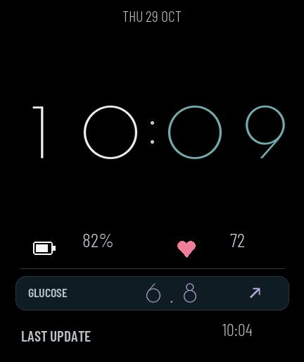

# Ottai → Redmi Watch 6 血糖镜像

2026-11-11：[表盘 0.1.19](releases/0.1.19/README.md) 为三款拆分独立 32 组配色：Signal 原色/字体/布局保留，Meridian 为 16 金属色调 + 16 塑料色调，Ultra 为 24 运动 + 8 商务的柔和主辅配色。Ultra 新增 LED 血糖/箭头信息板与同字号、等宽三栏的底部时间/电量/心率。Meridian/Ultra 已上传并获用户确认；Signal 的圆角裁切已有 [0.1.20 单款修补包](releases/0.1.20/README.md)，已上传并获用户确认 UI 正常；官方 3.59.2、原通知/后台授权与 HC 已恢复，原资料保留并确认一条锁屏自然新测量导出；USB 连接，不作非充电验收。完整状态见[交接](docs/HANDOFF.md)。

2026-11-11：[0.7.1光标读数](releases/cloud-0.7.1/README.md)已安装两端：鼠标悬停/手指横滑时显示同一条最近实际采样的时间、血糖值及单位；缺测显示无读数。原始事件选时、睡眠/锻炼区间及服务端0.7.0保持。

2026-11-11：[0.7.0睡眠与锻炼](releases/cloud-0.7.0/README.md)已安装两端并升级服务端：自动读取HC睡眠会话，在手机/Mac/组件血糖图上显示淡紫睡眠、淡绿锻炼区间，保留原始时间和血糖刻度。新生成的简报与主动详细解读均参考实际会话及对应血糖统计；手机新增睡眠读取由用户授权，真实上传与两端图形已核对。详见[活动接续](docs/HEALTH_CONNECT.md)。

2026-11-11：手动动态24h分析的准入覆盖率改为≥75%，保留跨度24h及最新读数10min要求；连续缺口保留供解读、不再单独拦截。个人历史完整日比较仍要求95%，既有30min间隔及自动日报不变。仅服务端更新，手机/Mac继续0.6.0；实测与心率排查见[接续记录](docs/CLOUD_SYNC_HANDOFF.md)。

2026-11-10：[0.6.0详细解读](releases/cloud-0.6.0/README.md)已完成开发与两端构建：动态24h、每日回顾各增加主动“详细解读”入口，原简洁报告保持。**两类详细解读都只在用户点击生成时调用模型**；打开、查询、切换及缓存到期均不自动生成。动态解读侧重所选时段的近期变化和餐次，固定日解读侧重该日与7/14天及更早历史的比较。缓存最长复用8h／24h，资料修正可更早主动生成新版，旧结果保留。两端已覆盖，动态真实生成/跨端查看与固定日隔离模型验收通过，接续见[云同步交接](docs/CLOUD_SYNC_HANDOFF.md)，方法见[详细解读依据](docs/DETAILED_ANALYSIS_METHOD.md)。

2026-11-10：[手机0.5.1修复版](releases/cloud-0.5.1/README.md)修复手动24h分析HTTP400，改为零字节POST；已覆盖安装并验证手机实际发起、生成及展示新报告。Mac/Widget与服务端继续0.5.0。

2026-11-10：[手机、Mac 与服务端 0.5.0](releases/cloud-0.5.0/README.md)新增时间标记和餐食录入，手机补齐动态24h分析与固定日报切换。主报告改为简短摘要、最多三张彩色重点卡片；相关研究依据折叠并按主题去重。Mac图表可悬停看时间、点击记录，手机支持手填餐食及显式拍照/图库识别。两端0.5.0已覆盖安装，真实标记同步和新版报告已验证；照片识别实际用量与完整验收见[功能说明](docs/EVENTS_AND_MEAL_PHOTOS.md)。官方小米运动健康和现有手表保持。

以下旧版本更新保留为历史记录；0.7.1为当前客户端版本，实际安装与验收状态以最新[接续记录](docs/CLOUD_SYNC_HANDOFF.md)为准。

2026-11-10：[Mac0.4.6](releases/cloud-0.4.6/README.md)去掉图标圆形描边，数字放大至14pt，保留淡色波形与仅图标范围警示。手机继续0.4.3。

2026-11-10：[Mac0.4.5](releases/cloud-0.4.5/README.md)淡化状态栏圆圈与波形，让完整数字更突出，保留仅图标范围警示；手机继续0.4.3。

2026-11-10：[Mac0.4.4](releases/cloud-0.4.4/README.md)状态栏采用应用风格的折线圆标与完整数字，透明隔离边防止图案切过字形。仅新鲜读数超出用户观察范围时给图标着色：低于3.9红色、高于7.8橙色；数字保持黑白，旧读数淡化。手机继续0.4.3。

2026-11-10：[0.4.3真实能量图](releases/cloud-0.4.3/README.md)按实际资料提供30分钟能量柱，手机/Mac/组件与15分钟步数、独立心率、血糖共用时间轴；保留旧客户端与AI原始区间语义。授权和真机验收见[活动接续](docs/HEALTH_CONNECT.md)。


2026-11-10：[0.4.2手机与Mac](releases/cloud-0.4.2/README.md)加入共享横轴的血糖/心率/活动多轨图；HC心率与估算活动能量、官方手机计步按独立来源处理，不共用纵轴、不合并不同单位。新版API和AI时序保留原始区间、缺测与分辨率信息。原官方运动健康和手表保持，完整实测状态见[接续记录](docs/HEALTH_CONNECT.md)。


2026-11-10：[手机0.4.0](releases/cloud-0.4.0/README.md)新增官方 Health Connect 的运动/心率/步数时序接入，云端固定日报和动态24h分析加入活动背景；手机调整为浅彩背景与白色卡片。授权、时间粒度及验收边界见 [Health Connect接续文档](docs/HEALTH_CONNECT.md)。官方小米运动健康、现有手表应用与表盘保留。

2026-11-10：[运动/历史心率关联可行性核查](docs/ACTIVITY_INTEGRATION_FEASIBILITY.md)确认当前官方运动健康声明Health Connect写权限、系统服务存在，但尚未授权/验证真实输出；活动曲线和AI关联接入仍是后续开发范围。

2026-11-10：[Mac0.3.0](releases/cloud-0.3.0/README.md)加入动态24h主动分析与前一自然日固定日报的独立存储/文本区切换。动态分析在完整性门槛通过后可用，每30min至多一次，同快照复用；自动日报每天08:15、累计真实资料超过72h后运行。含候选餐后样波动、健康研究参考及自身近期/较早历史比较，方法见[科学依据](docs/CGM_ANALYSIS_METHOD.md)。刷新改为图标，设置移至独立窗口。

2026-11-09 新功能：手机通知读数在原手表链路外独立排队上传 Ali；新增 Mac 菜单栏数值/趋势、24h 曲线、WidgetKit 通知中心组件及每日观察报告。每天的同一份报告同时比较近期和更长历史，没有单独周报调用。入口见 [云同步与 Mac 接续文档](docs/CLOUD_SYNC_HANDOFF.md)、[科学方法](docs/CGM_ANALYSIS_METHOD.md)、[服务端](server/README.md) 和 [Mac](macos/README.md)。

2026-11-09云通路基线：手机0.2.0完成正式上传及后台两轮自然更新；Ali持久化/重启保留、备份隔离恢复通过。Mac0.2.10移除刷新时的钥匙串读取，状态栏为半重叠水滴与Helvetica Neue Thin数值。通知中心空白已定位为共享文件权限拒绝，改为组件在自己的沙盒独立HTTPS读取；真实Provider已收到正式资料，屏显与后续刷新以[接续记录](docs/CLOUD_SYNC_HANDOFF.md)为准。每天08:15尝试一份含长短期比较的报告，正式资料超过72h才开始；临时合成数据库的真实模型链路已通过。官方小米运动健康继续保留，RPK/表盘本轮未升级。[发布包](releases/cloud-0.2.0/README.md)不包含私密配置。下文0.1.x版本及此前手表验收属于历史记录。

2026-10-30：针对每天同一时段配色疑似重复的反馈，已复现并修复选色器的低精度 Lua 兼容缺陷，三款 [0.1.18 安装包](releases/0.1.18/README.md) 已准备、尚未真机覆盖。32 组配色/切换点/字体/布局保持；当前手表仍为下述已验收版本，手机保留官方运动健康。此次未读取实际手表 Lua 编译配置，不将桌面复现直接当作真机根因或新包验收。

2026-10-29：三款显示已由用户确认。Ultra 保持 0.1.14；[Meridian 0.1.16](releases/0.1.16/README.md) 为极简指针/浅灰血糖/淡色趋势；[Signal 0.1.17](releases/0.1.17/README.md) 为 Poiret One 原字形时钟和紧凑血糖行。两款实际配色已核对，32 组沿用 04/11/15/19 切换。手表 RPK 0.1.12 的两条无圆点基准线已获确认。已还原官方小米运动健康 3.59.2，当前 Signal 下非充电锁屏两轮新数据自动更新通过，用户仅抬腕确认更新、表盘正常。完整边界见 [交接记录](docs/HANDOFF.md)。

把手机欧态 Ottai 通知中的血糖、趋势、原始测量时间，经小米运动健康的蓝牙通道发送到 Redmi Watch 6。包含独立应用「血糖镜像」与原创 Lua 表盘「Ottai Minimal」，无需 xDrip。

## 当前状态

| 项目 | 状态 |
| --- | --- |
| 手机蓝牙网关客户端 | 官方 3.59.2 已由用户重装并登录，绑定/原通知/后台授权与 HC 已恢复；确认一条锁屏自然新测量导出，修改版与安装器均已移除 |
| Android 通知监听、蓝牙桥接与云界面 | 0.7.1 / code22已安装；保留手表、生活标记与两类详细解读，新增HC睡眠读取及睡眠/锻炼区间 |
| Mac 与通知中心组件 | 0.7.1 / build21已安装；保留当前状态栏和详细解读，主图/共享组件新增睡眠与锻炼区间 |
| 云端与模型分析 | 简报方法v5加入睡眠/锻炼参考，详细解读仍100%手动；已部署并核对真实输入，旧报告保持 |
| Vela 手表应用 | 0.1.12 / code 13，新增两条图表基准线；安装成功，细线目视已通过，非充电锁屏两轮新测量更新通过 |
| 自定义血糖表盘 | Meridian/Ultra 0.1.19 已获用户确认；Signal 0.1.20 已获用户确认 UI 正常，见[本轮发布记录](releases/0.1.19/README.md) |
| 更新策略 | Ottai 新通知触发；表盘自动同步开启时，8 秒未收到文件导出确认才短暂唤起手表应用，写入后自动返回 |
| 缓存 | 进入时保留上次数值和测量时间，随后同步；断连不把旧数据伪装成新数据 |
| 上滑「小部件」 | 尚未找到可确认用于 Watch 6 第三方应用的公开接口 |

当前硬件组合：Xiaomi 15 / Android 16；Redmi Watch 6（M2523W1，固件 3.100.043，432×514）；Ottai 1.63.0。表盘 0.1.19 侧载曾按用户要求临时使用修改版，现修改版和安装器均已卸载；用户已重装并登录官方 3.59.2，HC 已恢复并完成 48h 快照同步，原活动记录仍在；原绑定保持，未解绑或重置。客户端回退包和运行证据只留本机私密目录，实际状态以[交接](docs/HANDOFF.md)为准。

**历史 2026-10-29 组合的官方客户端日常同步实测通过。** APK 0.1.11 + RPK 0.1.12 + Signal 0.1.17 下，官方服务已被镜像绑定，官方通知监听也已确认由系统实际绑定。锁屏、非充电的两条新源测量时间严格相差 5 分钟，各自源时间和通知时间均晚于测试起点，每轮只有一个通知元数据事件；收到通知后约 9.684／9.664 秒完成完整身份文件导出，ACK 约 9.715／9.693 秒。这是通知进入镜像后的处理耗时，不是传感器至屏显的总时延。每 45 秒采样均为两应用 FGS 后台、Dozing、非充电、豁免保持，无新增冻结。用户未手动打开两端镜像，仅抬腕确认最后一轮更新时间匹配、正常停留 Poiret One 表盘。临时安装器及本次手机调试临时文件已清理。

上述历史验收沿用既有 RPK/表盘；**官方客户端的新装、未来 RPK 升级侧载入口仍未验证，也未做换版后再次重启或多日验证。** 换版前的重启结果不覆盖新客户端。静态匹配、分项证据和边界见 [官方客户端兼容性](docs/official-mifit-compatibility.md)。

历史 2026-10-27 验证的表盘为 [0.1.12 时钟随机双色](releases/0.1.12/README.md)，已通过本地 SPP 覆盖安装，用户确认显示正常、息屏再抬腕颜色一致。每天当地时间 06／14／22 点，从 12 组经设计来源与黑底可读性筛选的方案中稳定伪随机选取整对；同段重载不变、相邻段不重复。手机和 RPK 不升级，血糖三色、布局、字号及黑底保持原样；真实跨时段目视尚未等待，边界逻辑已通过桌面测试。

切换前修改版客户端阶段的后台修复证据：后台刷新依赖正确的厂商省电策略；本机再次复发时，Android 标准页曾允许，但小米“电量详情 → 省电策略”实际仍为智能限制，进程被 Greezer 冻结。此次由用户在厂商页选择无限制，系统自动生成豁免，已确认一次重启后保留；未充电、锁屏的两个新测量周期均自动导出/回执，约 9.9／9.6 秒且无新增冻结，用户已只抬腕确认最后一轮原始时间匹配、正常停留表盘。本轮没有改源码或增加重试。详见 [后台排查](docs/background-running.md)。

[手表 0.1.9 试验](releases/watch-0.1.9/README.md) 未通过验收，不推荐安装：手动先黑屏后正常显示，透明未透出原表盘；两轮自动唤起未收到文件回执，失败原因未定位。已覆盖安装 [0.1.10 恢复包](releases/watch-0.1.10/README.md)，重建手机 SDK 连接后，两次旧测量恢复/状态更正均自动导出，用户确认已返回正常表盘且原始时间匹配。随后两个原始时间推进的读数也自动导出/回执，通知进入镜像后约 9.7 秒；首条较晚进入源通知，不能据此称两个严格正常周期，后两条未另取屏显确认。用户决定先保留短暂 UI 闪现，不继续优化。原后台三周期证据仍属于 0.1.8 RPK。试验代码归档与平台限制见 [减少闪现调研](docs/silent-sync-research.md)。

Ottai 约每 5 分钟更新一次。程序不轮询传感器、不提高 Ottai 刷新频率。当前固件未验证可靠的手表常驻后台接收，因此表盘采用上述短暂唤起后返回的方式，无需手动打开应用。0.1.11 每次未送达读数的发送尝试最多申请 20 秒 partial CPU wake lock，匹配文件回执后提前释放，保障关屏后的 8 秒回退；它不能代替 HyperOS 的后台冻结豁免。新安装时手机「表盘自动同步」默认关闭，使用表盘需要开启。表盘在创建、亮屏和恢复时读取文件，可见期间每 15 秒检查小文件，息屏暂停；长期耗电尚未测量。后台设置和验收边界见 [HyperOS 后台排查](docs/background-running.md)。



Ultra 采用 6×14 圆点大时钟与独立 32 组协调双色；血糖数值和趋势箭头位于统一 8px LED 栅格，未亮圆点为暗灰、点间保持黑色。底部原始测量时间、电量、心率使用原生 MiSans-Regular 28px，同一行高并列于三个等宽区域。布局在 `watchface/layout.json`；Signal/Meridian 的独立覆盖参数在 `watchface/faces.json`，配色规则见[说明](docs/clock-palettes.md)。

Ultra 血糖/趋势按显示值分段：`3.9 ≤ 值 ≤ 7.8` 浅紫 `#B57AFF`、`7.8 < 值 ≤ 12.0` 黄色、其余有效值红色；旧数据色系变暗，保留原始测量时间并另列 OLD。运行时仅取合法文件，预览使用合成值。

## 新环境快速开始

```sh
git clone git@github.com:joviliu/ottai_watch.git
cd ottai_watch
```

**直接安装**：手机 APK 与 Mac 使用 [0.7.1](releases/cloud-0.7.1/README.md)，Ultra/Meridian 制品见 [0.1.19](releases/0.1.19/README.md)、Signal 见 [0.1.20](releases/0.1.20/README.md)，手表应用为 [RPK 0.1.12](releases/watch-0.1.12/README.md)。先核对各目录 SHA256SUMS，按[交接](docs/HANDOFF.md)确认实际安装与恢复状态，保留已有数据与绑定。表盘通过 [SPP 临时安装器](tools/spp-installer/README.md)及自己设备的合法凭据上传，收尾恢复原客户端/授权并卸载安装器。官方日常同步的历史验收不代表官方侧载已通过；本轮 Broken pipe 与修改版对照结果分别记录。

**继续开发**：需要 Python 3、Node.js ≥18、JDK ≥17、Android SDK Platform 35 / Build Tools 35.0.0、OpenSSL。先运行不依赖 Android SDK 的测试：

```sh
export JDK=/absolute/path/to/jdk
sh tools/test.sh
```

首次构建：

```sh
# 先阅读 docs/signing.md：升级已安装的版本必须迁移原签名私钥。
sh tools/prepare_signing.sh
python3 tools/setup_android.py --sdk /absolute/path/to/android-sdk --jdk "$JDK"
. .toolchain/android.env
python3 tools/build_android.py
cd watch
npm ci
npm test
npm run release
cd ..
```

Android 产物在 `android/build/`；手表产物在 `watch/dist/`。如已有工具链，也可按 `tools/build.env.example` 手动设置环境变量。

表盘使用 Python 3.13（当前 CI）及 Node.js，桌面测试另需 Lupa：

```sh
python3 -m venv .toolchain/watchface-venv
.toolchain/watchface-venv/bin/pip install -r watchface/requirements.txt
.toolchain/watchface-venv/bin/python watchface/test_frame.py
.toolchain/watchface-venv/bin/python watchface/test_ui.py
.toolchain/watchface-venv/bin/python watchface/build.py
```

## 项目结构

- `android/src/`：通知解析、缓存、前台蓝牙服务、手机曲线/分析、生活标记和餐食照片。
- `server/`：独立云API、SQLite、活动/生活标记、统计与每日/动态分析。
- `macos/`：菜单栏应用、交互图表、标记编辑与WidgetKit通知中心组件。
- `deploy/relay/`：隔离的血糖分析与餐食照片relay/worker部署模板。
- `android/vendor/sdk/`：小米 Wearable SDK 源码，来源和修改见 `THIRD_PARTY_NOTICES.txt`。
- `watch/src/`：Vela JS 应用，包含消息/曲线校验、串行文件发布、缓存、展示和自动返回。
- `watchface/`：Lua 表盘、圆点字体素材生成、BIN/ZIP 打包及 Lua 模拟测试。
- `android/test/`、`watch/test/`：通知时间、非法帧、缓存、完整身份确认、异步发布顺序和自动返回测试。
- `tools/`：构建、签名、安装入口辅助脚本；`spp-installer/` 为独立 AGPL 开发安装器。
- `docs/`：协议、安装、签名、接续任务与快捷查看调研。
- `releases/`：本项目自己的签名安装包和校验和。

## 接续任务

云功能先读 [CLOUD_SYNC_HANDOFF](docs/CLOUD_SYNC_HANDOFF.md) 和 [标记与餐食照片](docs/EVENTS_AND_MEAL_PHOTOS.md)；手表功能先读 [HANDOFF](docs/HANDOFF.md)，再看 [数据协议](docs/protocol.md) 与 [快捷查看调研](docs/quick-view-research.md)。不要把「SDK 发送成功」当作「手表已显示」；手机界面分别显示发送状态、当前帧首次回执和最近回执。

本公开仓库不存放签名私钥、蓝牙配对密钥、账号、真实血糖日志、第三方 APK 或原厂表盘素材。签名迁移见 [签名说明](docs/signing.md)。主项目采用 GPL-3.0，独立 SPP 安装器采用 AGPL-3.0；第三方代码、字体及其许可证见 [THIRD_PARTY_NOTICES](THIRD_PARTY_NOTICES.txt)。
