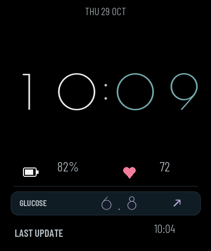

# Ottai → Redmi Watch 6 血糖镜像

2026-10-30：针对每天同一时段配色疑似重复的反馈，已复现并修复选色器的低精度 Lua 兼容缺陷，三款 [0.1.18 安装包](releases/0.1.18/README.md) 已准备、尚未真机覆盖。32 组配色/切换点/字体/布局保持；当前手表仍为下述已验收版本，手机保留官方运动健康。此次未读取实际手表 Lua 编译配置，不将桌面复现直接当作真机根因或新包验收。

2026-10-29：三款显示已由用户确认。Ultra 保持 0.1.14；[Meridian 0.1.16](releases/0.1.16/README.md) 为极简指针/浅灰血糖/淡色趋势；[Signal 0.1.17](releases/0.1.17/README.md) 为 Poiret One 原字形时钟和紧凑血糖行。两款实际配色已核对，32 组沿用 04/11/15/19 切换。手表 RPK 0.1.12 的两条无圆点基准线已获确认。已还原官方小米运动健康 3.59.2，当前 Signal 下非充电锁屏两轮新数据自动更新通过，用户仅抬腕确认更新、表盘正常。完整边界见 [交接记录](docs/HANDOFF.md)。

把手机欧态 Ottai 通知中的血糖、趋势、原始测量时间，经小米运动健康的蓝牙通道发送到 Redmi Watch 6。包含独立应用「血糖镜像」与原创 Lua 表盘「Ottai Minimal」，无需 xDrip。

## 当前状态

| 项目 | 状态 |
| --- | --- |
| 手机蓝牙网关客户端 | 已还原国行官方 3.59.2；修改版已卸载，两轮非充电锁屏更新及最后屏显验收通过 |
| Android 通知监听与蓝牙桥接 | 0.1.11 / code 12，增加通知后的短时 CPU 投递窗口、按读数身份的唤起冷却与监听恢复 |
| Vela 手表应用 | 0.1.12 / code 13，新增两条图表基准线；安装成功，细线目视已通过，非充电锁屏两轮新测量更新通过 |
| 自定义血糖表盘 | 已安装并由用户确认正常绘制、自动返回及显示新读数；连续更新证据见 [验证记录](docs/validation.md) |
| 更新策略 | Ottai 新通知触发；表盘自动同步开启时，8 秒未收到文件导出确认才短暂唤起手表应用，写入后自动返回 |
| 缓存 | 进入时保留上次数值和测量时间，随后同步；断连不把旧数据伪装成新数据 |
| 上滑「小部件」 | 尚未找到可确认用于 Watch 6 第三方应用的公开接口 |

当前实机组合：Xiaomi 15 / Android 16；Redmi Watch 6（M2523W1，固件 3.100.043，432×514）；Ottai 1.63.0；国行官方小米运动健康 3.59.2。用户先同步后已从修改版还原官方，已恢复同一设备连接，未解绑或重置。官方/修改版的回退包仅在本机私密目录保存；镜像和当前客户端均须设置厂商后台无限制。

**当前组合的官方客户端日常同步实测通过。** APK 0.1.11 + RPK 0.1.12 + Signal 0.1.17 下，官方服务已被镜像绑定，官方通知监听也已确认由系统实际绑定。锁屏、非充电的两条新源测量时间严格相差 5 分钟，各自源时间和通知时间均晚于测试起点，每轮只有一个通知元数据事件；收到通知后约 9.684／9.664 秒完成完整身份文件导出，ACK 约 9.715／9.693 秒。这是通知进入镜像后的处理耗时，不是传感器至屏显的总时延。每 45 秒采样均为两应用 FGS 后台、Dozing、非充电、豁免保持，无新增冻结。用户未手动打开两端镜像，仅抬腕确认最后一轮更新时间匹配、正常停留 Poiret One 表盘。临时安装器及本次手机调试临时文件已清理。

本次沿用既有 RPK/表盘；**官方客户端的新装、未来 RPK 升级侧载入口仍未验证，也未做换版后再次重启或多日验证。** 换版前的重启结果不覆盖新客户端。静态匹配、分项证据和边界见 [官方客户端兼容性](docs/official-mifit-compatibility.md)。

历史 2026-10-27 验证的表盘为 [0.1.12 时钟随机双色](releases/0.1.12/README.md)，已通过本地 SPP 覆盖安装，用户确认显示正常、息屏再抬腕颜色一致。每天当地时间 06／14／22 点，从 12 组经设计来源与黑底可读性筛选的方案中稳定伪随机选取整对；同段重载不变、相邻段不重复。手机和 RPK 不升级，血糖三色、布局、字号及黑底保持原样；真实跨时段目视尚未等待，边界逻辑已通过桌面测试。

切换前修改版客户端阶段的后台修复证据：后台刷新依赖正确的厂商省电策略；本机再次复发时，Android 标准页曾允许，但小米“电量详情 → 省电策略”实际仍为智能限制，进程被 Greezer 冻结。此次由用户在厂商页选择无限制，系统自动生成豁免，已确认一次重启后保留；未充电、锁屏的两个新测量周期均自动导出/回执，约 9.9／9.6 秒且无新增冻结，用户已只抬腕确认最后一轮原始时间匹配、正常停留表盘。本轮没有改源码或增加重试。详见 [后台排查](docs/background-running.md)。

[手表 0.1.9 试验](releases/watch-0.1.9/README.md) 未通过验收，不推荐安装：手动先黑屏后正常显示，透明未透出原表盘；两轮自动唤起未收到文件回执，失败原因未定位。已覆盖安装 [0.1.10 恢复包](releases/watch-0.1.10/README.md)，重建手机 SDK 连接后，两次旧测量恢复/状态更正均自动导出，用户确认已返回正常表盘且原始时间匹配。随后两个原始时间推进的读数也自动导出/回执，通知进入镜像后约 9.7 秒；首条较晚进入源通知，不能据此称两个严格正常周期，后两条未另取屏显确认。用户决定先保留短暂 UI 闪现，不继续优化。原后台三周期证据仍属于 0.1.8 RPK。试验代码归档与平台限制见 [减少闪现调研](docs/silent-sync-research.md)。

Ottai 约每 5 分钟更新一次。程序不轮询传感器、不提高 Ottai 刷新频率。当前固件未验证可靠的手表常驻后台接收，因此表盘采用上述短暂唤起后返回的方式，无需手动打开应用。0.1.11 每次未送达读数的发送尝试最多申请 20 秒 partial CPU wake lock，匹配文件回执后提前释放，保障关屏后的 8 秒回退；它不能代替 HyperOS 的后台冻结豁免。新安装时手机「表盘自动同步」默认关闭，使用表盘需要开启。表盘在创建、亮屏和恢复时读取文件，可见期间每 15 秒检查小文件，息屏暂停；长期耗电尚未测量。后台设置和验收边界见 [HyperOS 后台排查](docs/background-running.md)。



Ultra 表盘显示紧凑日期、完整圆点大时钟（无冒号）、动态分段颜色血糖与趋势、原始测量时间、电量与心率。现源码时钟已扩展为 [32 组协调双色](docs/clock-palettes.md)，白橙为其中一组，实机安装状态见上文。时钟采用 6×14 点阵，数字间距加宽，日期与时钟区约占屏幕上方 3/5；血糖采用更小、更稀疏的 5×7 点阵，数值居中，左侧更新时间放大提亮，右侧显示趋势箭头。布局参数在 `watchface/layout.json`。运行时血糖仅取自合法数据文件，安装缩略图使用占位。

Ultra 血糖数值与趋势箭头按用户指定的显示区间同步变色：`3.9 ≤ 值 ≤ 7.8` 紫色，`7.8 < 值 ≤ 12.0` 黄色，其余红色。判定使用表盘显示的一位小数；旧数据同色系变暗并保留原始时间及 `OLD`。

## 新环境快速开始

```sh
git clone git@github.com:joviliu/ottai_watch.git
cd ottai_watch
```

**直接安装**：手机 APK 沿用 [0.1.11](releases/0.1.11)，Signal 使用 [0.1.17](releases/0.1.17/README.md)，Meridian 使用 [0.1.16](releases/0.1.16/README.md)，Ultra 沿用 0.1.14，手表应用为 [RPK 0.1.12](releases/watch-0.1.12/README.md)。先核对各目录 SHA256SUMS，按 [安装文档](docs/install.md) 和 [交接记录](docs/HANDOFF.md) 确认实际版本，勿重复清除已有数据。表盘通过 [SPP 临时安装器](tools/spp-installer/README.md) 上传，使用自己设备的合法配对凭据，结束卸载。官方版曾通过日常同步，但本轮上传在其环境下中断；修改版对照已完成三款上传，不能把这项结果直接解释为官方禁止表盘安装。修改版已确认可覆盖升级 RPK；官方 RPK 侧载入口仍未验。

**继续开发**：需要 Python 3、Node.js ≥18、JDK ≥17、Android SDK Platform 35 / Build Tools 35.0.0、OpenSSL。先运行不依赖 Android SDK 的测试：

```sh
export JDK=/absolute/path/to/jdk
sh tools/test.sh
```

首次构建：

```sh
# 先阅读 docs/signing.md：升级已安装的版本必须迁移原签名私钥。
sh tools/prepare_signing.sh
python3 tools/setup_android.py --sdk /absolute/path/to/android-sdk --jdk "$JDK"
. .toolchain/android.env
python3 tools/build_android.py
cd watch
npm ci
npm test
npm run release
cd ..
```

Android 产物在 `android/build/`；手表产物在 `watch/dist/`。如已有工具链，也可按 `tools/build.env.example` 手动设置环境变量。

表盘使用 Python 3.13（当前 CI）及 Node.js，桌面测试另需 Lupa：

```sh
python3 -m venv .toolchain/watchface-venv
.toolchain/watchface-venv/bin/pip install -r watchface/requirements.txt
.toolchain/watchface-venv/bin/python watchface/test_frame.py
.toolchain/watchface-venv/bin/python watchface/test_ui.py
.toolchain/watchface-venv/bin/python watchface/build.py
```

## 项目结构

- `android/src/`：通知解析、缓存、前台蓝牙服务、手机界面及图标。
- `android/vendor/sdk/`：小米 Wearable SDK 源码，来源和修改见 `THIRD_PARTY_NOTICES.txt`。
- `watch/src/`：Vela JS 应用，包含消息/曲线校验、串行文件发布、缓存、展示和自动返回。
- `watchface/`：Lua 表盘、圆点字体素材生成、BIN/ZIP 打包及 Lua 模拟测试。
- `android/test/`、`watch/test/`：通知时间、非法帧、缓存、完整身份确认、异步发布顺序和自动返回测试。
- `tools/`：构建、签名、安装入口辅助脚本；`spp-installer/` 为独立 AGPL 开发安装器。
- `docs/`：协议、安装、签名、接续任务与快捷查看调研。
- `releases/`：本项目自己的签名安装包和校验和。

## 接续任务

先读 [HANDOFF](docs/HANDOFF.md)，再看 [数据协议](docs/protocol.md) 与 [快捷查看调研](docs/quick-view-research.md)。不要把「SDK 发送成功」当作「手表已显示」；手机界面分别显示发送状态、当前帧首次回执和最近回执。

本公开仓库不存放签名私钥、蓝牙配对密钥、账号、真实血糖日志、第三方 APK 或原厂表盘素材。签名迁移见 [签名说明](docs/signing.md)。主项目采用 GPL-3.0，独立 SPP 安装器采用 AGPL-3.0；第三方代码、字体及其许可证见 [THIRD_PARTY_NOTICES](THIRD_PARTY_NOTICES.txt)。
