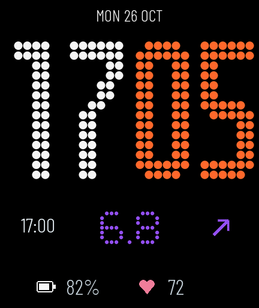

# Ottai → Redmi Watch 6 血糖镜像

把手机欧态 Ottai 通知中的血糖、趋势、原始测量时间，经小米运动健康的蓝牙通道发送到 Redmi Watch 6。包含独立应用「血糖镜像」与原创 Lua 表盘「Ottai Minimal」，无需 xDrip。

## 当前状态

| 项目 | 状态 |
| --- | --- |
| Android 通知监听与蓝牙桥接 | 0.1.10 / code 11，通知与应用图标资源为蓝底白折线，另有透明白色通知小图标 |
| Vela 手表应用 | 0.1.8 / code 9，数值、趋势、曲线及双槽表盘文件导出 |
| 自定义血糖表盘 | 已安装并由用户确认正常绘制、自动返回及显示新读数；连续更新证据见 [验证记录](docs/validation.md) |
| 更新策略 | Ottai 新通知触发；表盘自动同步开启时，8 秒未收到文件导出确认才短暂唤起手表应用，写入后自动返回 |
| 缓存 | 进入时保留上次数值和测量时间，随后同步；断连不把旧数据伪装成新数据 |
| 上滑「小部件」 | 尚未找到可确认用于 Watch 6 第三方应用的公开接口 |

当前实机组合：Xiaomi 15 / Android 16；Redmi Watch 6（M2523W1，固件 3.100.043，432×514）；Ottai `com.ottai.tag` 1.63.0；Mi Fitness mod `com.xiaomi.wearable` 3.33.6i m0tral v141。兼容性结论仅覆盖这套组合。

Ottai 约每 5 分钟更新一次。程序不轮询传感器、不提高 Ottai 刷新频率。当前固件未验证可靠的常驻后台接收，因此表盘采用上述短暂唤起后返回的方式，无需手动打开应用。新安装时手机「表盘自动同步」默认关闭，使用表盘需要开启。表盘在创建、亮屏和恢复时读取文件，可见期间每 15 秒检查小文件，息屏暂停；长期耗电尚未测量。



表盘显示紧凑日期、完整圆点大时钟（小时白色、分钟橙色、无冒号）、亮紫色血糖与趋势、原始测量时间、电量与心率。时钟采用 6×14 点阵，数字间距加宽，日期与时钟区约占屏幕上方 3/5；血糖采用更小、更稀疏的 5×7 点阵，数值居中，左侧更新时间放大提亮，右侧显示趋势箭头。布局参数在 `watchface/layout.json`。运行时血糖仅取自合法数据文件，安装缩略图使用占位。

血糖数值与趋势箭头按用户指定的显示区间同步变色：`3.9 ≤ 值 ≤ 7.8` 紫色，`7.8 < 值 ≤ 12.0` 黄色，其余红色。判定使用表盘显示的一位小数；旧数据同色系变暗并保留原始时间及 `OLD`。

## 新环境快速开始

```sh
git clone git@github.com:joviliu/ottai_watch.git
cd ottai_watch
```

**直接安装**：使用 [releases/0.1.10](releases/0.1.10) 的手机 APK 与新版表盘 BIN，搭配 [0.1.8 RPK](releases/0.1.8/glucose-watch6-0.1.8.rpk)，先核对各目录的 `SHA256SUMS`；参照 [安装与排查](docs/install.md) 和 [表盘工程](watchface/README.md)。0.1.10 只调整 UI，手表应用和同步协议保持 0.1.8。安装包不包含运行时健康数据和账号。表盘目前通过 [本地 SPP 开发安装器](tools/spp-installer/README.md) 上传，需要自己设备的合法配对凭据；Mi Fitness 的开发表盘授权接口在本次实测返回 HTTP 404。旧版本保留用于历史追溯。

**继续开发**：需要 Python 3、Node.js ≥18、JDK ≥17、Android SDK Platform 35 / Build Tools 35.0.0、OpenSSL。先运行不依赖 Android SDK 的测试：

```sh
export JDK=/absolute/path/to/jdk
sh tools/test.sh
```

首次构建：

```sh
# 先阅读 docs/signing.md：升级已安装的版本必须迁移原签名私钥。
sh tools/prepare_signing.sh
python3 tools/setup_android.py --sdk /absolute/path/to/android-sdk --jdk "$JDK"
. .toolchain/android.env
python3 tools/build_android.py
cd watch
npm ci
npm test
npm run release
cd ..
```

Android 产物在 `android/build/`；手表产物在 `watch/dist/`。如已有工具链，也可按 `tools/build.env.example` 手动设置环境变量。

表盘使用 Python 3.13（当前 CI）及 Node.js，桌面测试另需 Lupa：

```sh
python3 -m venv .toolchain/watchface-venv
.toolchain/watchface-venv/bin/pip install -r watchface/requirements.txt
.toolchain/watchface-venv/bin/python watchface/test_frame.py
.toolchain/watchface-venv/bin/python watchface/test_ui.py
.toolchain/watchface-venv/bin/python watchface/build.py
```

## 项目结构

- `android/src/`：通知解析、缓存、前台蓝牙服务、手机界面及图标。
- `android/vendor/sdk/`：小米 Wearable SDK 源码，来源和修改见 `THIRD_PARTY_NOTICES.txt`。
- `watch/src/`：Vela JS 应用，包含消息/曲线校验、串行文件发布、缓存、展示和自动返回。
- `watchface/`：Lua 表盘、圆点字体素材生成、BIN/ZIP 打包及 Lua 模拟测试。
- `android/test/`、`watch/test/`：通知时间、非法帧、缓存、完整身份确认、异步发布顺序和自动返回测试。
- `tools/`：构建、签名、安装入口辅助脚本；`spp-installer/` 为独立 AGPL 开发安装器。
- `docs/`：协议、安装、签名、接续任务与快捷查看调研。
- `releases/`：本项目自己的签名安装包和校验和。

## 接续任务

先读 [HANDOFF](docs/HANDOFF.md)，再看 [数据协议](docs/protocol.md) 与 [快捷查看调研](docs/quick-view-research.md)。不要把「SDK 发送成功」当作「手表已显示」；手机界面分别显示发送状态、当前帧首次回执和最近回执。

本公开仓库不存放签名私钥、蓝牙配对密钥、账号、真实血糖日志、第三方 APK 或原厂表盘素材。签名迁移见 [签名说明](docs/signing.md)。主项目采用 GPL-3.0，独立 SPP 安装器采用 AGPL-3.0；第三方代码、字体及其许可证见 [THIRD_PARTY_NOTICES](THIRD_PARTY_NOTICES.txt)。
